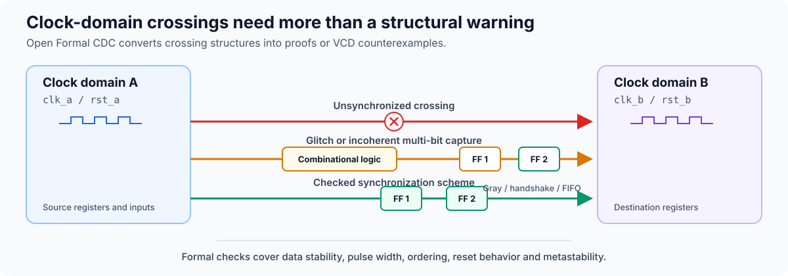
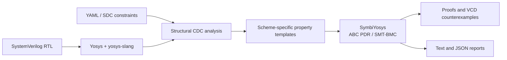

# Open Formal CDC

**Open-source structural and formal verification of clock-domain crossings in SystemVerilog RTL.**

[](LICENSE)
[](#project-status)

Open Formal CDC finds clock-domain crossings, recognizes synchronization schemes, generates formal properties, and proves them with **Yosys** and **SymbiYosys**. For a failing property, it produces a counterexample and a VCD trace instead of relying only on simulation or structural warnings.

It is designed for open-source ASIC/FPGA verification flows, CDC research, and regression testing of RTL blocks.

<p align="center">
  
</p>

## What it detects

- **Unsynchronized crossings** and incomplete or incorrectly connected synchronizer chains.
- **Unsafe multi-bit transfers**, including non-Gray source transitions and independently synchronized bus bits.
- **Handshake and enable violations**, such as data changing while the destination is allowed to capture it.
- **Asynchronous FIFO errors**: overflow, underflow, data-order violations, and failures caused by independent resets.
- **Pulse, glitch, divergence, and reconvergence risks**, including combinational logic before a synchronizer.
- **Selected metastability and reset-domain failures**, using an explicit old-or-new-value metastability model.

Formal checks can run in two independent time models: a compact tick-based model and `clk2fflogic`. YAML/SDC assumptions constrain clocks, resets, and inputs; internal assumptions can have formal checker twins. For under-constrained properties, `open-formal-cdc infer` mines protocol assumptions from multiple counterexamples and applies Plassan's eight filters. It currently supports `en_stable`, `gray`, and `hs_req`; inferred assumptions are reported for user review, never accepted automatically.

## How it works



The Python and Verilog property templates are part of the repository, so checks can be inspected, extended, and reproduced without a commercial formal-verification license.

## Quick start

### Requirements

- Linux, Python 3.12 or newer.
- A recent [OSS CAD Suite](https://github.com/YosysHQ/oss-cad-suite-build), including Yosys with the `slang` plugin and SymbiYosys.
- SSH and rsync only if jobs are executed on a remote machine.

From a project checkout:

```bash
python3 -m venv .venv
.venv/bin/pip install -e .
export PATH="/path/to/oss-cad-suite/bin:$PATH"

.venv/bin/open-formal-cdc run examples/gray_sync/ofcdc.yaml
```

The example checks a correct Gray-code synchronizer and two faulty variants. An abridged report looks like this:

```text
variant  check          template  ticks   clk2ff  outcome  expected
base     gray_u_tx_ptr  gray      proven  proven  proven   proven    ok
base     meta_u_tx_ptr  nonew     proven  proven  proven   proven    ok
binary   gray_u_tx_ptr  gray      cex@6   cex@7   cex      cex       ok
```

Results are written to `examples/gray_sync/build/ofcdc/`:

- `results.json`: check outcomes and counterexample depths;
- `cdc_model.json`: crossings, schemes, assumptions, and verdicts;
- `<variant>/jobs/`: generated SBY jobs and VCD traces.

To run only structural analysis:

```bash
.venv/bin/open-formal-cdc analyze examples/glitch_conv/ofcdc.yaml
```

For your own RTL, copy an example from [`examples/`](examples/) and describe the top module, clocks, resets, and input domains in YAML. The full format is documented in [`docs/config.md`](docs/config.md). Remote execution is available with `-x ssh:user@host:~/.ssh/key`.

## Comparison with commercial CDC tools

| Aspect | Open Formal CDC | Cadence Jasper CDC |
|---|---|---|
| Distribution | Apache-2.0, open Python and Verilog sources | Commercial |
| Verification engine | Yosys, SymbiYosys, ABC and SMT solvers | Cadence static and formal engines |
| CDC workflow | Structural analysis plus generated formal checks | Integrated structural and formal CDC analysis |
| Customization | Editable templates, user checks, synchronizer-cell descriptions, YAML/SDC | Vendor features and user configuration |
| Current scope | Regression-tested CDC templates; selected reset and metastability checks; explicit-cut and property-directed CEGAR; advanced RDC/MSI work in progress | Mature commercial CDC/RDC and metastability solution |
| Typical use | Open flows, research, customization, CI | Cadence-based verification and signoff |

Open Formal CDC does **not** claim feature or signoff equivalence with either commercial product.

## Benchmarks

The directed v2 suite contains 19 variants: 7 known-good controls and 12 faulty variants with 13 independent CDC/RDC faults. Both tools processed the same generated RTL in three fresh-directory runs. Each cell below shows **faults found; total median time for all variants of that design**.

| Design | Open Formal CDC | Jasper CDC |
|---|---:|---:|
| Gray-code synchronizer | **2/2; 2.14 s** | **2/2; 14.78 s** |
| Handshake data transfer | **1/1; 1.52 s** | **1/1; 9.86 s** |
| Asynchronous FIFO | **3/3; 31.33 s** | 1/3; 22.47 s |
| Pulse-width check | **1/1; 0.95 s** | **1/1; 9.76 s** |
| Glitch and reconvergence | **3/3; 1.54 s** | 0/3; 14.78 s |
| M5 shared-source reconvergence | **2/2; 2.74 s** | **2/2; 15.62 s** |
| Static configuration | **1/1; 0.79 s** | **1/1; 9.46 s** |
| **Overall** | **13/13; 41.01 s** | **8/13; 96.73 s** |

Measured with Open Formal CDC 0.0.1 and Jasper CDC 2019.06p001 on the same 16-core host. This is a comparison of automatic CDC flows, without hand-written design-specific SVA for the commercial tools. A warning present in both the good and faulty variants does not count as detection of the mutation. The detailed report preserves the exact evidence for every score.

The [detailed per-case results](benchmarks/results/summary.md) include the exact property or rule behind every score. See [benchmark methodology and reproduction commands](benchmarks/README.md). The M4 ablation reports `hazard_candidate` for both Gray and binary cases and `discharged` for the paired `00 <-> 11` case: `onechange` fails there, but M4 proves no function hazard. The Gray result is a function-hazard candidate under free clock relations, not a claim that Gray encoding itself is broken. Separately, the public `cdc-rdc-tests` run covers 213 directed cases, with 209 exact matches in 41 s.

### Larger designs

A separate seven-case suite compares larger synthetic and real-IP runs. Times below are from one recorded run per case.

| Case | Open Formal CDC | Jasper CDC |
|---|---:|---:|
| 64-channel CDC array | 14.84 s | 5.38 s |
| RISC-V JTAG debug transport | 42.86 s | 244.90 s |
| AXI SPI slave | 151.66 s | 125.02 s, protocol checks only |

For the two known synthetic mutations, Open Formal CDC detected **2/2** and Jasper **0/2**. Jasper's Gray signature also fails on the known-good array and therefore does not count as mutation detection. The real-IP cases have no reviewed fault ledger yet, so their reports are not presented as confirmed bug counts. AXI SPI uses `clk2fflogic` in Open Formal CDC; Jasper omits its unsupported conditional-waiver proof phase. The current large-suite total is 217.74 s. The rIC3 proof engine reduced AXI SPI unknown checks from two to one. An isolated CEGAR run confirmed an AXI SPI counterexample on the full model in 63 s. Reducing the standard large-run from eight to four parallel jobs resolved the remaining timeout: all 18 AXI SPI checks now produce counterexamples in 151.66 s. The parallel-8 result is preserved separately for comparison. A Boolector cover search at depth 100 closed all five RISC-V DMI checks on the full model, with data-change and capture witnesses at steps 60 and 63.

See the [full large-design results](benchmarks/large/results/summary.md) and [execution conditions](benchmarks/large/README.md).

[Real-IP configurations](benchmarks/real_ip/) cover a RISC-V JTAG debug transport and an AXI SPI slave with dual-clock FIFOs. A [scalable synthetic array](benchmarks/synthetic/) provides 4 to 64 channels and up to 128 crossings. Larger OpenTitan/PULP-based SoC designs remain future work.

## Project status

Open Formal CDC is an actively developed research prototype. The implemented examples currently pass **119 unit tests and 27 end-to-end Yosys/SymbiYosys tests**, including automatic M5 proposals for direct, logic-between-stages, fanout, sliced-vector, shared-source reconvergent, declared user-cell, and attributed packed-vector chains, plus M6 reset-release and M7 asynchronous-skew models in both time models. The external RDC-001 regression passes **9/9** cases, RDC-002 passes **7/7**, RDC-003 passes **8/8**, RDC-004 passes **6/6**, RDC-005 passes **8/8**, RDC-006 passes **6/6**, RDC-007 passes **9/9**, RDC-008 passes **10/10**, RDC-010 passes **28/28**, RDC-011 passes **10/10**, and RDC-009 passes **10/10** cases in both time models. The T-CLKMUX regression passes **4/4** cases, including an AND/OR glitch-free design whose `clock_select` protocol is inferred structurally. Two user-guided inference rounds recover both request/acknowledge protocol rules, and the joint proof passes in both time models. The next milestones are counterexample justification, stuttering generalization, GenBuf validation, richer reports, and adapters for other CDC tools.

```bash
.venv/bin/pip install -e '.[dev]'
.venv/bin/pytest -q tests/unit
OFCDC_EXECUTOR=local .venv/bin/pytest -q tests/flow
```

## Documentation

- [Architecture and correctness policy](docs/architecture.md)
- [YAML/SDC configuration and property templates](docs/config.md)
- [Development plan](docs/plan.md)
- [Validation on external CDC/RDC cases](docs/validation.md)
- [Examples with correct and faulty RTL](examples/)

## License

Released under [Apache-2.0](LICENSE). Generated properties, SBY jobs, and reports are not restricted by the tool license. External contributions require a DCO `Signed-off-by` line.

Cadence and Jasper are trademarks of their respective owners.
